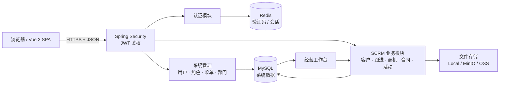

<div align="center">

# SCRM · 客户经营管理系统

**一套开箱即用的客户关系管理与销售协同平台**

客户档案 · 销售漏斗 · 合同回款 · 营销活动 · 数据看板 · RBAC 权限

[](https://openjdk.org/)
[](https://spring.io/projects/spring-boot)
[](https://vuejs.org/)
[](https://element-plus.org/)
[](https://www.mysql.com/)
[](LICENSE)

</div>

> [!NOTE]
> 这是一个前后端分离的 SCRM 演示项目，包含从客户获取、跟进、商机、合同到经营分析的核心闭环。代码结构清晰、启动步骤完整，适合用于学习、课程设计、内部原型和二次开发；生产部署前请按[上线检查清单](#生产环境检查清单)完成安全加固。

## 项目简介

项目以一个「B2B 销售团队」的日常工作流为线索，将客户资料、跟进记录、销售机会和合同数据组织到同一套业务模型中，并通过工作台和统计图表呈现团队经营情况。

- **业务闭环**：客户建档 → 分配/领取 → 跟进 → 商机推进 → 合同签约 → 业绩分析。
- **完整权限**：基于 RBAC 的菜单、按钮和数据范围控制，内置管理员、部门主管、部门成员等角色。
- **前后端分离**：Spring Boot REST API + Vue 3 单页应用，接口文档随服务自动生成。
- **可复现运行**：提供数据库初始化脚本、Docker Compose 和示例环境变量，一条命令拉起 MySQL 与 Redis。
- **可扩展底座**：在通用后台能力之上扩展 SCRM 业务模块，便于继续增加线索、回款、工单等场景。

## 功能一览

### 业务功能

| 模块 | 能力 |
| --- | --- |
| 经营工作台 | 客户/跟进/商机/合同 KPI，客户与跟进趋势、客户来源、销售漏斗、销售排行、待跟进客户、最近动态 |
| 客户管理 | 客户分页与高级筛选、客户档案、标签、公海池、批量分配、公海领取、客户详情、跟进记录 |
| 销售管理 | 商机阶段与赢单概率管理、合同全生命周期管理、客户维度合同查询、跟进时间线 |
| 营销管理 | 活动预算、渠道、起止时间、目标/实际线索数、活动状态管理 |
| 数据看板 | 面向管理者的经营概览与多维度统计展示 |

### 平台能力

| 模块 | 能力 |
| --- | --- |
| 认证与会话 | 图形验证码、JWT 登录、刷新令牌、退出登录、登录日志 |
| 权限体系 | 用户、角色、菜单、按钮权限、部门、数据权限 |
| 系统管理 | 字典、参数配置、通知公告、操作日志、文件存储 |
| 开发工具 | 在线接口文档、代码生成器、动态表单、工作流示例 |
| 前端体验 | 动态路由、页签、暗黑模式、国际化、Excel 导入导出、ECharts 图表 |

## 技术栈

| 层次 | 技术 |
| --- | --- |
| 前端 | Vue 3.5、TypeScript、Vite 8、Element Plus 2.14、Pinia、Vue Router、ECharts 6、UnoCSS |
| 后端 | Java 17+、Spring Boot 4.0.1、Spring Security、JWT、MyBatis-Plus、Druid |
| 数据 | MySQL 8.0、Redis 7 |
| 文档与集成 | SpringDoc / Knife4j、WebSocket、本地/MinIO/阿里云 OSS 文件存储 |
| 工程化 | pnpm、ESLint、Prettier、Stylelint、Husky、Maven |

## 系统架构



更完整的模块划分、数据模型与权限链路见 [docs/architecture.md](docs/architecture.md)。

## 快速开始

### 环境要求

| 依赖 | 版本 |
| --- | --- |
| JDK | 17 或更高 |
| Maven | 3.9+ |
| Node.js | `^20.19.0` 或 `>=22.12.0` |
| pnpm | 8+ |
| Docker | 可选，推荐用于启动 MySQL 与 Redis |

### 1. 准备环境变量

```bash
cp .env.example .env
```

打开 `.env`，至少修改以下三项，并保证 `DB_PASSWORD` 与 `MYSQL_ROOT_PASSWORD` 一致：

```dotenv
MYSQL_ROOT_PASSWORD=你的数据库密码
REDIS_PASSWORD=你的Redis密码
JWT_SECRET=至少32位的随机字符串
```

生成随机 JWT 密钥：

```bash
openssl rand -base64 48
```

在当前终端导入变量。Spring Boot 和后端进程会从这里读取配置：

```bash
set -a && . ./.env && set +a
```

> 使用 IntelliJ IDEA 启动时，也可以在 Run Configuration 中逐项配置同名环境变量。请勿把真实密钥写入仓库。

### 2. 启动 MySQL 与 Redis

```bash
docker compose up -d
```

首次启动会自动执行：

1. `backend/sql/mysql/youlai_admin.sql`：系统基础库与演示账号；
2. `sql/scrm.sql`：SCRM 业务表、菜单与演示数据。

查看初始化状态：

```bash
docker compose logs -f mysql
```

### 3. 启动后端

```bash
cd backend
mvn spring-boot:run
```

- API 地址：<http://localhost:8000>
- Knife4j 文档：<http://localhost:8000/doc.html>
- OpenAPI JSON：<http://localhost:8000/v3/api-docs>

### 4. 启动前端

另开一个终端：

```bash
cd frontend
pnpm install
pnpm dev
```

访问 <http://localhost:3000>。

### 默认账号

| 账号 | 密码 | 角色 |
| --- | --- | --- |
| `admin` | `123456` | 系统管理员 |
| `dept_member` | `123456` | 部门成员 |

> 演示账号仅用于本地体验。部署到任何可被他人访问的环境前，请立即修改密码和 `JWT_SECRET`。

## 配置说明

后端配置位于 `backend/src/main/resources/`。敏感项全部通过环境变量注入：

| 变量 | 说明 | 必填 |
| --- | --- | --- |
| `DB_HOST` / `DB_PORT` / `DB_NAME` | MySQL 地址、端口、数据库名 | 是 |
| `DB_USERNAME` / `DB_PASSWORD` | MySQL 账号与密码 | 是 |
| `REDIS_HOST` / `REDIS_PORT` / `REDIS_DATABASE` | Redis 连接信息 | 是 |
| `REDIS_PASSWORD` | Redis 密码 | 是 |
| `JWT_SECRET` | JWT HS256 密钥，至少 32 字符 | 是 |
| `FILE_STORAGE_PATH` | 本地上传目录 | 否 |
| `MAIL_*` | 邮件服务 | 否 |
| `MINIO_*` / `ALIYUN_OSS_*` | 对象存储 | 否 |
| `WX_MINIAPP_*` | 微信小程序登录 | 否 |

默认开发端口为：前端 `3000`、后端 `8000`、MySQL `3307`、Redis `6379`。如端口冲突，可通过 `.env` 同时调整容器端口和后端连接端口。

## 目录结构

```text
scrm/
├── backend/                         # Spring Boot 后端
│   ├── sql/mysql/                   # 基础系统 SQL（来自 youlai-boot）
│   └── src/main/java/com/youlai/boot/
│       ├── auth/                    # 登录、验证码、令牌
│       ├── security/                # Spring Security、JWT
│       ├── system/                  # 用户、角色、菜单、部门等
│       ├── module/scrm/             # SCRM 业务模块
│       └── support/                 # 邮件、短信、WebSocket
├── frontend/                        # Vue 3 前端
│   └── src/
│       ├── api/scrm/                # SCRM API 封装
│       ├── views/customer/          # 客户与公海
│       ├── views/sales/             # 商机、合同、跟进
│       ├── views/marketing/         # 营销活动
│       ├── views/dashboard/         # 经营工作台
│       └── views/system/            # 系统管理页面
├── sql/scrm.sql                     # SCRM 业务表与演示数据
├── docs/                            # 项目文档
├── docker-compose.yml
├── .env.example
└── README.md
```

## 主要 API

所有接口以 `/api/v1` 开头，统一返回 `{ code, msg, data }`；分页接口的 `data` 为 `{ list, total }`。

| 分组 | 基础路径 | 说明 |
| --- | --- | --- |
| 认证 | `/api/v1/auth` | 验证码、登录、刷新令牌、退出 |
| 客户 | `/api/v1/scrm/customers` | 客户 CRUD、公海、分配、领取、下拉选项 |
| 客户标签 | `/api/v1/scrm/tags` | 标签 CRUD |
| 跟进记录 | `/api/v1/scrm/follow-ups` | 跟进 CRUD、客户跟进列表 |
| 商机 | `/api/v1/scrm/opportunities` | 商机 CRUD、客户商机列表 |
| 合同 | `/api/v1/scrm/contracts` | 合同 CRUD、客户合同列表 |
| 营销活动 | `/api/v1/scrm/campaigns` | 活动 CRUD |
| 工作台 | `/api/v1/scrm/dashboard` | 经营指标与图表数据 |

完整参数、权限码和响应示例见 [docs/api.md](docs/api.md)。服务启动后也可直接在 Knife4j 中调试。

## 生产环境检查清单

- [ ] 修改所有演示账号密码，删除不用的账号。
- [ ] 使用独立、随机的 `JWT_SECRET`，不要复用示例值。
- [ ] 通过环境变量或密钥管理服务注入数据库、Redis 和第三方平台凭据。
- [ ] 将 `SPRING_PROFILES_ACTIVE` 设为 `prod`，关闭 Knife4j 与不必要的 Actuator 端点。
- [ ] 为前端和后端配置 HTTPS、反向代理、限流与安全响应头。
- [ ] 将 MySQL/Redis 移出公网，限制来源 IP，并建立备份与恢复演练。
- [ ] 按组织要求配置日志脱敏、审计留存和数据访问权限。

## 文档

- [架构设计](docs/architecture.md)
- [API 说明](docs/api.md)
- [部署指南](docs/deployment.md)
- [贡献指南](CONTRIBUTING.md)
- [安全策略](SECURITY.md)
- [第三方声明](THIRD_PARTY_NOTICES.md)

## 贡献

欢迎提交 Issue 与 Pull Request。开始前请阅读 [CONTRIBUTING.md](CONTRIBUTING.md)，并确保不提交任何真实客户数据、账号密码或第三方平台密钥。

## 许可证与致谢

本项目原创部分以 [Apache License 2.0](LICENSE) 发布。前端和后端分别基于以下优秀的开源项目二次开发，保留其原始许可证与版权声明：

- [vue3-element-admin](https://github.com/youlaitech/vue3-element-admin)（MIT）
- [youlai-boot](https://github.com/haoxianrui/youlai-boot)（Apache-2.0）
- [vue-element-admin](https://github.com/PanJiaChen/vue-element-admin)（MIT）

详细归属见 [THIRD_PARTY_NOTICES.md](THIRD_PARTY_NOTICES.md)。感谢所有上游作者与贡献者。
