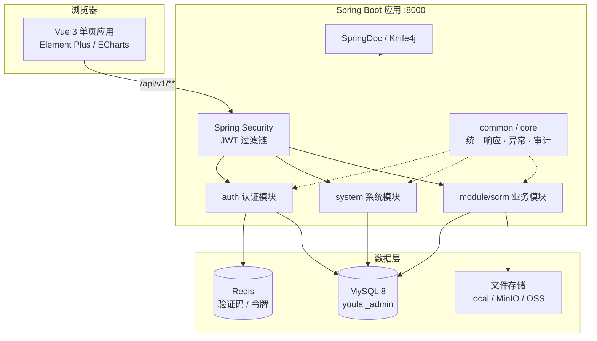
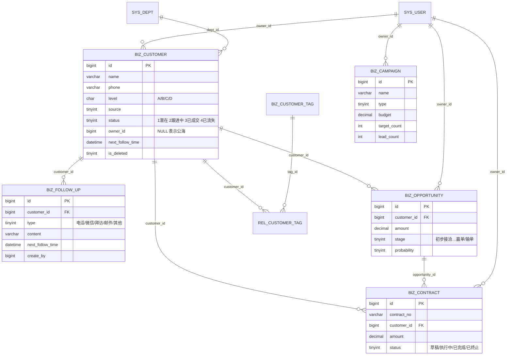
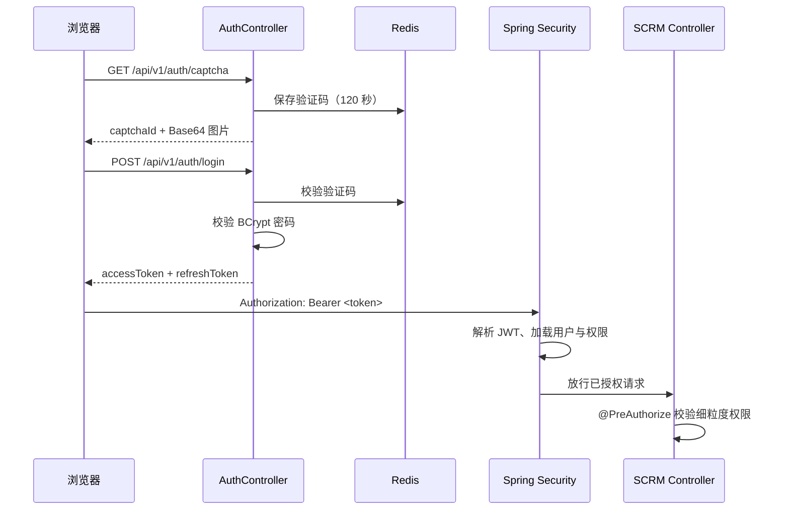

# 架构设计

本文说明通用 SCRM 的模块边界、核心数据模型、认证与权限链路，以及几个容易被忽略的工程约定。

## 1. 总体架构



开发环境由 Vite 将 `/dev-api` 代理到 `http://localhost:8000`；生产环境通常由 Nginx 将静态资源与 `/prod-api` 分别转发到前端文件和后端服务。

## 2. 后端模块划分

```text
com.youlai.boot
├── auth              # 验证码、账号密码登录、令牌刷新
├── security          # JWT、认证过滤器、安全处理器、权限表达式
├── system            # 用户、角色、菜单、部门、字典、配置、通知、日志
├── module/scrm       # SCRM 业务域
│   ├── controller    # REST 入口
│   ├── service       # 业务编排
│   ├── mapper        # MyBatis-Plus 持久化
│   ├── model         # entity / form / query / vo / bo
│   └── support       # 业务辅助逻辑
├── module/codegen    # 代码生成
├── module/file       # 文件能力
├── support           # 邮件、短信、WebSocket
├── common            # 通用常量、枚举、响应体
└── config            # Jackson、Redis、Swagger 等配置
```

### 分层约定

- `controller` 只负责参数接收、权限声明与统一响应，不承载业务规则。
- `form` 用于写请求，`query` 用于查询条件，`vo` 用于响应，`entity` 不直接暴露给前端。
- 业务表统一使用 `is_deleted` 逻辑删除字段，MyBatis-Plus 全局配置 `logic-delete-field: isDeleted`。
- 对象 ID 使用雪花或数据库自增 `bigint`，API 输出为字符串，避免 JavaScript `Number` 精度丢失。
- 异常由全局异常处理器转换为 `{ code, msg, data }`，业务错误码沿用 `A/B/C + 四位数字` 规范。

## 3. 前端结构

```text
frontend/src
├── api/                  # Axios 封装，按领域拆分
│   ├── auth/
│   ├── system/
│   └── scrm/
├── layouts/              # 后台主布局
├── router/               # 静态路由 + 动态路由注入
├── stores/               # Pinia：用户、权限、应用状态
├── components/           # 通用组件
├── views/
│   ├── dashboard/        # 经营工作台
│   ├── customer/         # 客户列表、公海
│   ├── sales/            # 商机、合同、跟进
│   ├── marketing/        # 营销活动
│   ├── system/           # 系统管理
│   └── scrm/components/  # 客户选择器、跟进弹窗、详情抽屉
├── utils/                # 请求、格式化、权限指令
└── styles/               # 全局样式与主题变量
```

前端采用「静态基础路由 + 后端菜单动态注入」的方式：登录后拉取当前用户的菜单与按钮权限，再生成可访问路由。页面中的操作按钮通过权限指令或权限码控制展示。

## 4. 核心数据模型



### 关键业务约定

| 主题 | 约定 |
| --- | --- |
| 公海 | `biz_customer.owner_id IS NULL` 且未删除的记录属于公海 |
| 客户状态 | `1` 潜在、`2` 跟进中、`3` 已成交、`4` 已流失 |
| 商机阶段 | `1` 初步接洽、`2` 需求确认、`3` 方案报价、`4` 商务谈判、`5` 赢单、`6` 输单 |
| 合同状态 | `1` 草稿、`2` 执行中、`3` 已完成、`4` 已终止 |
| 跟进方式 | `1` 电话、`2` 微信、`3` 拜访、`4` 邮件、`5` 其他 |
| 删除策略 | 全表逻辑删除，保留审计痕迹 |

`sql/scrm.sql` 与基础脚本使用 `DROP TABLE IF EXISTS` 重建业务表，适合演示环境初始化，不要直接用于已有生产数据。

## 5. 认证与权限链路



权限码采用 `scrm:<资源>:<动作>` 的命名方式，例如：

- `scrm:customer:list` / `create` / `update` / `delete` / `assign` / `claim`
- `scrm:follow-up:list` / `create` / `update` / `delete`
- `scrm:opportunity:*`
- `scrm:contract:*`
- `scrm:campaign:*`
- `scrm:tag:*`

角色与菜单关系存放在 `sys_role_menu`，数据范围由 `sys_role.data_scope` 与部门树共同决定。新增业务菜单时，应同步补充菜单记录、权限码和角色授权。

## 6. 工作台聚合

`GET /api/v1/scrm/dashboard` 聚合了多个维度，便于前端一次渲染：

- 客户总数、最近新增、公海数量、跟进次数；
- 商机金额、合同金额、本月赢单率；
- 客户/跟进趋势、客户来源、销售阶段；
- 待跟进客户、最近跟进、销售排行。

数据来自当前登录用户可见范围内的业务表。生产环境数据量增大后，建议将趋势与排行改为按日预聚合，或为 `owner_id`、`create_time`、`status`、`is_deleted` 建立组合索引并缓存统计结果。

## 7. 可扩展方向

1. **线索与客户拆分**：增加独立线索表与转化流程，保留来源渠道。
2. **回款与发票**：在合同下增加回款计划、实收记录和开票状态。
3. **团队协作**：客户协作人、跟进提醒、消息订阅。
4. **数据权限细化**：按部门、角色、字段级别控制可见数据。
5. **审计与合规**：字段变更历史、导出审计、数据脱敏。
6. **自动化**：基于事件总线的分配规则、跟进提醒和营销触达。

## 8. 已知边界

- 演示数据为虚构内容，不对应真实企业或联系人。
- 短信、邮件、对象存储、微信登录默认未配置；需要在 `.env` 中提供凭据并验证。
- 代码生成、工作流、动态表单等平台示例模块来自上游模板，未针对 SCRM 场景做深度定制。
- 当前测试以构建、接口冒烟和页面联调为主，尚无完整的自动化测试基线。
